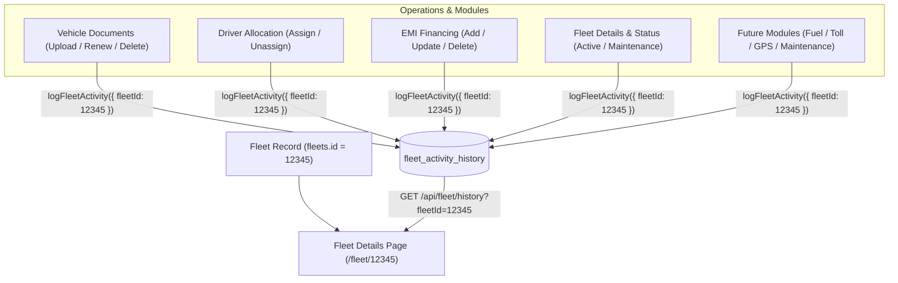

# CargoDesk Fleet Details & Centralized Activity History System

## 1. Overview & Architecture

The **Fleet Details & Centralized Activity History System** connects the entire operational lifecycle of a commercial fleet vehicle to its permanent, immutable database identifier (`fleetId` / `fleets.id`). 

Every operational mutation across **Documents**, **EMI Financing**, **Driver Allocation/Removal**, **Fleet Vehicle Specifications**, **Status Transitions**, and **Maintenance** automatically logs an immutable audit event linked to `fleetId`.



---

## 2. Database Schema: `fleet_activity_history`

| Column | Type | Description |
| :--- | :--- | :--- |
| `id` | `INT AUTO_INCREMENT` | Unique Audit Record ID (Primary Key) |
| `fleet_id` | `INT NOT NULL` | Permanent Foreign Key to `fleets.id` |
| `operation_type` | `VARCHAR(50)` | High-level module: `FLEET`, `DOCUMENT`, `DRIVER`, `EMI`, `MAINTENANCE`, `STATUS` |
| `entity_type` | `VARCHAR(50)` | Granular entity: `VEHICLE_INFO`, `DRIVER_ALLOCATION`, `INSURANCE`, `PUC`, `FINANCE_EMI`, `STATUS_CHANGE` |
| `entity_id` | `VARCHAR(50)` | Specific entity ID (e.g. document ID, driver ID, EMI ID) |
| `action` | `VARCHAR(30)` | Mutation action: `CREATE`, `UPDATE`, `DELETE`, `ASSIGN`, `UNASSIGN`, `UPLOAD`, `RENEW`, `ACTIVATE`, `DEACTIVATE` |
| `title` | `VARCHAR(255)` | Human-readable title for UI cards (e.g. `Insurance document updated`) |
| `description` | `TEXT` | Detailed narrative / diff summary (e.g. `Expiry date changed from 20 Feb 2026 → 20 Feb 2027`) |
| `old_value` | `LONGTEXT / JSON` | Previous state snapshot for differential auditing |
| `new_value` | `LONGTEXT / JSON` | Updated state snapshot |
| `changed_fields`| `JSON` | Array of modified keys (`["expiryDate", "alertDate"]`) |
| `performed_by` | `VARCHAR(50)` | Authenticated User ID |
| `performed_by_name` | `VARCHAR(100)` | User Name (e.g. `Suraj Sangale`, `Muhammed Asfaq`) |
| `performed_at` | `TIMESTAMP` | Exact timestamp of operation |
| `source` | `VARCHAR(50)` | Initiating module/channel (`documents`, `driver`, `emi`, `fleets`) |
| `metadata` | `LONGTEXT / JSON` | Contextual extra data |

### Composite Indexes for Sub-Millisecond Queries
```sql
INDEX idx_fleet_hist_fleet_time (fleet_id, performed_at DESC)
INDEX idx_fleet_hist_fleet_op (fleet_id, operation_type)
INDEX idx_fleet_hist_fleet_action (fleet_id, action)
INDEX idx_fleet_hist_entity (entity_type, entity_id)
INDEX idx_fleet_hist_user (performed_by)
```

---

## 3. End-to-End Operational Flow

### A. Opening a Fleet Details Page (`/fleet/:fleetId` or `/fleets/:fleetId`)
1. **Route Activation**: User navigates to `/fleet/4` or clicks any vehicle registration number in the table.
2. **SSR Pre-fetching**: `getServerSideProps` executes `getFleetByIdController(4)` and `getFleetActivityHistoryModel({ fleetId: 4, page: 1, limit: 20 })`.
3. **Client Presentation**:
   - **Header**: Displays Vehicle Number, Status Badge (`Active`), specs subtitle (`Tata 407 • Goods Carrier • 4 Wheeler`), and CTA buttons (`Edit Fleet`, `+ Add Document`).
   - **Tabs Bar**: Shows real-time badge counts for `Documents (5)`, `EMI (1)`, `Driver (2)`, `Maintenance (1)`, and active `Activity History`.
   - **Left Column Summary Card**: Sticky specifications grid with truck photo, Fleet ID (`FL-000004`), Chassis No, Engine No, RC Expiry, Fuel Type, and copy actions.
   - **Right Column Activity Timeline**: Chronological events grouped by date with category pills (`All`, `Documents`, `Driver`, `EMI`, `Maintenance`, `Vehicle Details`, `Status`), date range filters, and audit detail inspection drawer.

### B. Performing an Operation (e.g. Document Renewal / Driver Assignment)
1. User uploads a renewed Insurance document or assigns a new Driver in CargoDesk.
2. The mutation model performs the database update.
3. Upon success, `logFleetActivity({ fleetId, operationType, action, oldValue, newValue, performedByName, source })` is automatically executed.
4. Field diffs are calculated and logged into `fleet_activity_history`.
5. The Timeline on `/fleet/:fleetId` instantly reflects the new activity under today's date group.

---

## 4. API Endpoints Reference

### 1. Get Fleet Details by ID
```http
GET /api/fleet/get-by-id?id=4
```
**Response**:
```json
{
  "status": true,
  "data": {
    "id": 4,
    "vehicle_number": "MH 03 CD 5678",
    "vehicle_model": "Tata 407",
    "vehicle_type": "Goods Carrier",
    "status": "Active",
    "driver_name": "Rahul Sharma",
    "counts": {
      "documents": 5,
      "emi": 1,
      "driver": 2,
      "maintenance": 1
    }
  }
}
```

### 2. Get Chronological Fleet Activity History
```http
GET /api/fleet/history?fleetId=4&page=1&limit=20&type=DOCUMENT
```
**Query Parameters**:
- `fleetId`: Target fleet identifier (*required*)
- `type` / `operationType`: `ALL`, `DOCUMENT`, `DRIVER`, `EMI`, `MAINTENANCE`, `VEHICLE_DETAILS`, `STATUS`
- `action`: `CREATE`, `UPDATE`, `DELETE`, `ASSIGN`, `UNASSIGN`, `UPLOAD`, `RENEW`
- `fromDate` & `toDate`: `YYYY-MM-DD`
- `search`: Fulltext substring match on titles, descriptions, and user names
- `page`: Page number (1-indexed)
- `limit`: Page size (default: 20, max: 100)

**Response**:
```json
{
  "status": true,
  "fleetId": 4,
  "data": [
    {
      "id": 108,
      "fleetId": 4,
      "operationType": "DOCUMENT",
      "entityType": "INSURANCE",
      "action": "RENEW",
      "title": "Insurance document updated",
      "description": "Expiry date changed from 20 Feb 2026 → 20 Feb 2027",
      "performedByName": "Suraj Sangale",
      "performedAt": "2026-09-25T10:30:00.000Z",
      "source": "documents"
    }
  ],
  "pagination": {
    "page": 1,
    "limit": 20,
    "total": 48,
    "totalPages": 3,
    "hasMore": true
  },
  "summary": {
    "all": 48,
    "documents": 12,
    "driver": 8,
    "emi": 6,
    "maintenance": 5,
    "vehicleDetails": 4,
    "status": 3
  }
}
```

---

## 5. Adding Future Fleet Modules

Whenever a new module is added in the future (e.g. **Fuel**, **Tolls**, **GPS Telematics**, **Services**):
1. Simply import and call `logFleetActivity` in your module's mutation:
```javascript
import { logFleetActivity } from "@/backend/models/fleetActivityModel";

await logFleetActivity({
  fleetId: payload.fleetId,
  operationType: "FUEL",
  entityType: "FUEL_DISPATCH",
  entityId: String(newFuelLogId),
  action: "CREATE",
  title: "Fuel refilled",
  description: "Added 60 Liters Diesel at Pune Depot Station",
  performedByName: req.user?.name || "Operations User",
  source: "fuel",
  newValue: payload,
});
```
2. The Activity History on `/fleet/:fleetId` will automatically render the new events without requiring any structural changes.
